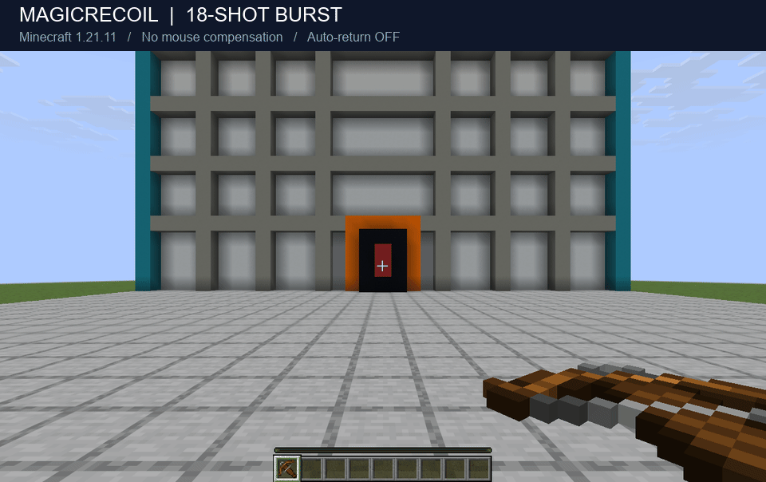

# MagicRecoil

[English](README.md) · [한국어](README.ko.md) · [상세 한국어 문서](docs/ko/README.md) · [Wiki](https://github.com/minjae9010/MagicRecoil/wiki)

**Paper 1.21.4 이상에서 기존 MagicSpells 총기에 시점 반동을 추가하는 애드온입니다.**

발사체, 탄약, 데미지, 재장전, 효과, 연사 로직은 기존 설정을 사용합니다. 기존 반동 주문을 `RecoilSpell`로 교체하면 한 발의 yaw/pitch 변화량을 여러 서버 틱으로 나누어 적용합니다. 마우스로 반동을 제어할 수 있도록 상대 회전을 사용하며, 기본값에서는 시점을 이전 각도로 강제로 되돌리지 않습니다.

> **실험 버전입니다.** 서버 패킷으로 구현한 FPS 반동 근사치이며 VALORANT와 같은 프레임 단위 카메라 애니메이션을 보장하지 않습니다. 빌드·자동 테스트·로컬 서버 패킷 검증과, 실제 사람이 확인해야 하는 조작감·지연·안티치트·원본 총기 검증은 [테스트 문서](docs/ko/testing.md)에 구분했습니다.

처음 사용하면 **[빠른 시작](docs/ko/getting-started.md)**부터 읽으세요. 수평 반동 문제는 **[증상별 진단](docs/ko/troubleshooting.md)**, 전체 문서 탐색은 **[문서 안내](docs/ko/README.md)** 또는 **[Wiki](https://github.com/minjae9010/MagicRecoil/wiki)**에서 시작할 수 있습니다.

이 버전은 이동 중 반동 배율, 첫 발부터 적용되는 수평 패턴, 단발 쿨타임 표시를 추가합니다. [v0.3.0-alpha.3](https://github.com/minjae9010/MagicRecoil/releases/tag/v0.3.0-alpha.3)

<!-- toc:start -->
## 목차

- [헤드샷·방향·거리 데미지와 적중 스펠](#헤드샷방향거리-데미지와-적중-스펠)
- [우클릭 연사와 좌클릭 줌](#우클릭-연사와-좌클릭-줌)
- [반동 테스트 GIF](#반동-테스트-gif)
- [지원 환경](#지원-환경)
- [설치](#설치)
- [실제 총기용 예시](#실제-총기용-예시)
- [반동 계산과 설정 규칙](#반동-계산과-설정-규칙)
- [기능](#기능)
- [설정과 문서](#설정과-문서)
- [리로드와 명령어](#리로드와-명령어)
- [Gradle 빌드](#gradle-빌드)
- [도입 전에 확인할 한계](#도입-전에-확인할-한계)
- [라이선스](#라이선스)
- [선택 기능: 조준](#선택-기능-조준)
<!-- toc:end -->

## 헤드샷·방향·거리 데미지와 적중 스펠

`dev.magicrecoil.spells.HitSpell`로 즉시 명중 사격 또는 기존 `ParticleProjectileSpell`의 적중 콜백을 처리합니다. 머리·몸통, 피격자 기준 앞·뒤·좌·우·위·아래, 거리별 선형 배율을 설정하고 공통·머리/몸통·방향별 후속 스펠을 실행할 수 있습니다.

```yaml
MyGun_Hit:
  spell-class: dev.magicrecoil.spells.HitSpell
  helper-spell: true
  can-target: [players, nonplayers]
  damage: 6
  headshot-multiplier: 2
  direction-multipliers: {back: 1.5}
  distance-damage:
    - {distance: 0, multiplier: 1}
    - {distance: 50, multiplier: 0.5}
  # 효과 스펠을 별도로 정의한 다음 주석을 해제하세요.
  # spell-on-headshot: MyGun_HeadshotEffect
```

기존 파티클 발사체에는 `spell-on-hit-entity: "MyGun_Hit(targeting=entity_from_location)"`를 연결합니다. 즉시 사격은 반동 전에 `"MyGun_Hit(targeting=none)"`를 실행합니다. 수영·활강 플레이어도 눈높이 명중은 헤드샷이며 아래쪽 몸통은 구분합니다. 피해 중복을 막도록 이전 데미지 콜백을 교체하고, 반동은 발사 성공 직후에 유지하세요. [전체 안내](docs/ko/hit-detection.md) · [완성 YAML 예제](examples/hit-integration.yml).

**자동 테스트 216개와 두 플레이어 PvP·자세 검증 92개 모두 통과**했습니다. 이전에 실패한 수영·활강 눈높이 4개도 포함합니다. 실제 연결된 Player를 자동 클라이언트로 검사했으며, 렌더링·사람의 조작·이동 표적·지연·보호 플러그인 조합은 별도 검수가 필요합니다. 전체 빌드/API 검사와 일반 명중·조준·리로드 회귀 결과는 [테스트 문서](docs/ko/testing.md)에 있습니다.

## 우클릭 연사와 좌클릭 줌

| 조작 | 동작 |
| --- | --- |
| 우클릭 유지 | 앞으로 최대 5개의 발사 기회를 보충하고 기존 전체 발사 처리를 호출 |
| 우클릭 해제 | 남은 버퍼가 최대 5틱 안에 소진. 20 TPS에서 약 0.25초 |
| 좌클릭 | Slowness 줌 ON/OFF. 조준 중 이동속도가 줄고 반동 배율은 1.0 유지 |
| 재장전·무기 교체·사망·로그아웃 | 연결한 훅으로 발사를 중지하고 조준 정리 |

기존 총기 설정에 [right-click-paimon.yml](examples/right-click-paimon.yml)과 [aim-paimon.yml](examples/aim-paimon.yml)을 병합하세요. 현재 magic item, 탄약 변수, 재장전 조건, 발사체·소리·반동 주문을 유지합니다. 기존 사격 Buff의 마우스 바인딩을 제거하여 연사 루프를 하나만 실행하고, 이벤트 없는 direct 재장전에는 StopAutoFireSpell을 맨 앞에서 호출하세요. [전체 설정과 연동 안내](docs/ko/aim-and-input.md)에서 세부 옵션과 이전 조작을 설명합니다.

클라이언트 모드와 ProtocolLib은 필요 없습니다. BUFFERED_CLICK 모드는 총기를 망원경으로 바꾸거나 사용 컴포넌트를 붙이지 않습니다. 클라이언트 FOV 효과가 0%면 화면 확대는 보이지 않으며 시각적인 확대 정도와 전체 운영 총기는 게임 내 확인이 필요합니다. 현재 릴리즈는 자동 테스트 216개를 통과했으며, 기존 연사·줌의 실제 Paper 입력·탄약/반동·포션 복원·재시작 검증 기록도 유지합니다. [검증 결과](docs/ko/testing.md#crackshot-조작-검증)를 참고하세요.

## 반동 테스트 GIF



로컬 Paper 서버의 실제 Minecraft 1.21.11 화면을 MCP로 캡처했습니다. 3틱 간격으로 18발을 발사하며 `auto-return: false`, 마우스 보정 없음 설정입니다. 석궁은 화면 표시용이고 발사는 MagicSpells 주문으로 실행합니다. 캡처 속도는 약 **5 FPS**이므로 반동 누적과 최종 시점을 확인하는 용도이며, 실시간 부드러움 평가는 별도로 해야 합니다. [촬영 상세](docs/ko/testing.md#반동-시연-녹화)와 [재현용 구성](tests/runtime/README.md#visual-burst-fixture)을 참고하세요.

> 이 GIF는 **0.1.0-alpha.1의 이전 패턴**을 촬영한 기록입니다. 현재 내장 valorant는 좌우 중심 이동과 누적 상승 상한을 사용하므로 결과가 다릅니다.

## 지원 환경

| 구성 요소 | 대상 |
| --- | --- |
| 서버 | Paper **1.21.4 이상**, 호환되는 네이티브 회전 API 필요 |
| Java | **21 이상**. 서버가 요구하는 Java 사용(26.x는 Java 25) |
| MagicSpells | **4.0-Beta-17 이상**. API가 호환되는 이후 베타·RC·정식 버전 포함 |
| 빌드 | **Gradle 9.3.0**, Wrapper 포함 |
| ProtocolLib | 불필요 |
| 클라이언트 | 서버와 일치하는 바닐라 Java 클라이언트. 기본 반동에 모드 불필요 |

체크섬을 고정한 공식 MagicSpells Beta 17 API로 컴파일하고, 시작 시 필요한 API를 확인합니다. 파일명만 바꾼 JAR은 바이너리 호환성을 보장하지 않습니다. 공식 배포본에는 자체 EffectLib이 포함되어 있으며, MagicRecoil은 별도 EffectLib을 직접 사용하지 않습니다. 기존 MagicSpells 배포본이 요구하는 의존성은 유지하세요.

버전 완전 일치 제한을 제거했습니다. 이후 버전도 필요한 API가 호환되면 허용하고, API가 맞지 않으면 시작 시 원인을 출력하고 중지합니다. 상대 회전을 지원하는 서버는 상대 회전을, 이전 프로토콜은 절대각도 회전 전용 패킷을 자동 선택합니다. 절대각도 패킷은 전송 중 마우스 입력을 덮어쓸 수 있습니다. Folia는 지원하지 않으며 버전 변환·수정 배포본은 별도 검증이 필요합니다. [버전 호환 안내](docs/ko/compatibility.md)에 기준과 검증 범위를 정리했습니다.

## 설치

1. 아래 방법으로 현재 `MagicRecoil-0.3.0-alpha.3.jar`를 빌드하거나, [Releases](https://github.com/minjae9010/MagicRecoil/releases)에서 필요한 호환 범위의 배포본을 선택합니다.
2. 서버를 종료하고 MagicSpells와 함께 `plugins/`에 넣습니다. `plugins/MagicSpells/` 안에는 중복 JAR을 넣지 않습니다.
3. `plugins/MagicSpells/spells-recoil.yml`에 다음 주문을 작성합니다.

   ```yaml
   MyGun_Recoil:
     spell-class: "dev.magicrecoil.spells.RecoilSpell"
     recoil: 2.5
   ```

4. 서버를 시작합니다. 콘솔에서 `Enabled rotation:` 메시지와 주문 로딩 오류 유무를 확인합니다.
5. 콘솔에서 `ms cast as 플레이어이름 MyGun_Recoil`로 시험합니다. 플레이어의 `/ms cast MyGun_Recoil`은 MagicSpells 권한과 주문 소유 조건을 충족해야 합니다.
6. 실제 총기에는 [연동 가이드](docs/ko/integration.md)에 따라 발사 성공 조건과 재장전 중지 처리를 연결합니다.

**전체 클래스명**을 사용해야 합니다. Beta 18은 `.RecoilSpell`을 MagicSpells 자신의 패키지로 확장하므로 외부 애드온의 짧은 이름으로 사용할 수 없습니다. 공식 클래스 로더 API를 사용하며 MagicSpells 본체 JAR을 수정하지 않습니다.

## 실제 총기용 예시

```yaml
MyGun_Recoil:
  spell-class: "dev.magicrecoil.spells.RecoilSpell"
  helper-spell: true
  recoil: 2.5
  vertical: 1.0
  horizontal: 0.4
  smoothness: 0.8
  growth: 0.08
  reset-delay: 400
  pattern: valorant
  auto-return: false
  require-success-of: MyGun_Projectile
  stop-on-spells: [MyGun_Reload_Start]
  stop-on-buff-end: [MyGun_Firing_Buff]
```

참조하는 주문 이름 세 개는 실제 이름으로 바꿉니다. 기존의 **발사 성공 분기**에서 `MyGun_Projectile` 다음에 `MyGun_Recoil`을 같은 틱에 연속 실행합니다. 성공 기록은 한 번만 소비됩니다. 단, 원래 총기에 탄약 검사가 없다면 애드온이 이를 대신 만들지는 않습니다. MagicSpells의 기본 partial 하위 주문 호출은 일반 비용·쿨다운 검사를 모두 수행하지 않으므로 기존 조건을 반드시 확인해야 합니다.

이번 탄환을 먼저 발사하고 그 뒤 새 반동을 예약합니다. 후속 탄환은 서버가 알고 있는 변경된 조준 방향을 사용합니다. 산탄총은 펠릿마다 반동을 호출하지 말고 한 번 발사할 때 한 번 호출하세요.

## 반동 계산과 설정 규칙

**`horizontal`은 각도가 아니라 패턴의 수평 계수에 곱하는 배율입니다. 계수가 0이면 배율만 높여도 좌우로 움직이지 않습니다.**

```text
강도 = recoil × (1 + growth × 발사번호)   # 첫 발은 0
yaw   = 수평 계수 × horizontal × 강도   # 양수: 오른쪽
pitch = -수직 계수 × vertical × 강도    # 음수: 위쪽
```

| 원하는 동작 | 설정 규칙 |
| --- | --- |
| 위쪽으로만 반동 | `pattern: vertical`. 기본 bias·범위에서는 `horizontal`을 올려도 수평 0 |
| 연사 초반 상승 후 좌우 흔들림 | `pattern: valorant`. 기본 첫 **4발 수평 0**; 이후 중앙의 좌우로 이동하며 누적 상승은 `valorant-max-rise`에서 제한 |
| 첫 발부터 무작위 좌우 반동 | `pattern: random`과 수평 범위·배율 지정 |
| 직접 정한 순서대로 반동 | `pattern: custom`과 `custom-pattern`의 수직·수평 계수 지정 |

예를 들어 아래 수치는 발당 위쪽 **0.5°**, 무작위 좌우 **-0.75°..+0.75°**입니다. 기존 `RecoilSpell` 아래에 넣고 발사 연결·중지 옵션은 유지합니다.

```yaml
recoil: 0.5
vertical: 1.0
horizontal: 1.5
pattern: random
vertical-min: 1.0
vertical-max: 1.0
horizontal-min: -1.0
horizontal-max: 1.0
growth: 0.0
recoil-steps: 2
auto-return: false
```

수직 범위를 1로 고정하지 않으면 random의 기본 범위 0..2에 따라 위쪽 강도도 달라집니다. 수평 값은 범위 안에서 추출하므로 방향이 항상 번갈아 나오지는 않습니다. 발당·틱당·시야 제한에 걸리면 실제 적용량이 줄어듭니다.

2틱은 `2/3, 1/3`으로 나누며, `recoil-steps`가 `smoothness`보다 우선합니다. `reset-delay`는 연사 패턴 초기화 간격이고 자동 복귀가 아닙니다. 발사 간격이 기본 400ms 이상이면 valorant은 매번 첫 발부터 시작하므로 수평 구간에 도달하지 못합니다.

계수·잡음·bias·제한의 정확한 순서, 모든 패턴과 연사·복귀 규칙은 **[반동 로직 상세](docs/ko/recoil-logic.md)**에서 이어서 설명합니다. 수평이 보이지 않으면 **[수평 반동 진단](docs/ko/troubleshooting.md#수평-반동이-없음)**을 먼저 확인하세요.

## 기능

- 플레이어별 연사 증가, `valorant` / `vertical` / `horizontal` / `random` / `custom` 패턴.
- AR, SMG, LMG, SR, DMR, SG, 권총 예시. 총기 분류를 Java 코드에 고정하지 않습니다.
- 사용자 패턴의 반복, 마지막 점 유지, 종료 후 무반동 처리.
- 위치·속도·텔레포트 확인 번호가 없는 상대 회전 전용 패킷.
- 공용 동기 스케줄러 하나, 플레이어마다 최대 20칸의 버퍼, 틱당 플레이어당 반동 패킷 최대 하나.
- 숫자 유효성 검사, 발당·틱당 제한, 위아래 시점 제한.
- 무기 주문 전환, 인벤토리 조작, 사망, 로그아웃, 텔레포트, 월드 이동, 리로드 시 정리.
- 선택적 자동 복귀. 기본은 꺼져 있으며 저장한 절대 시점으로 돌아가지 않습니다.

## 설정과 문서

| 문서 | 내용 |
| --- | --- |
| [설치와 첫 발사](docs/ko/getting-started.md) | 처음 설치, 최소 주문, 콘솔 시험 |
| [반동 로직 상세](docs/ko/recoil-logic.md) | 수평·수직 계산식, 패턴, 분할·중첩·초기화 |
| [증상별 문제 해결](docs/ko/troubleshooting.md) | 수평 0, 전체 무반동, 강도와 탄퍼짐 |
| [설정 전체 설명](docs/ko/configuration.md) | 단위, 범위, 적용 순서, 충돌 처리, 패턴 |
| [연동 가이드](docs/ko/integration.md) | 발사 성공 확인, 재장전, 범용 총기 연동, 문제 해결 |
| [구조와 기술 조사](docs/ko/architecture.md) | Paper API·상대 패킷·ProtocolLib·NMS 비교 |
| [테스트와 한계](docs/ko/testing.md) | 실제 확인한 항목, 재현 절차, 수동 검수 항목 |
| [개발 가이드](docs/ko/development.md) | 빌드, 코드 구조, CI, 차기 버전 대응 |
| [총기 예시 YAML](examples/recoil-examples.yml) | 숫자 중심 프리셋과 사용자 패턴 |
| [총기 반동 연동 YAML](examples/weapon-integration.yml) | 기존 반동 주문 블록만 교체 |

범용 연동 예시는 `Weapon_AR_Recoil`, `Weapon_AR_Projectile` 같은 영어 식별자를 사용하므로 기존 총기에 맞춰 모든 참조를 연결해야 합니다. 원본 전체를 검토·수정한 완성본은 아닙니다. 탄약·발사체·재장전·효과·ON/OFF 로직은 원본에서 유지하고 검증해야 합니다.

## 리로드와 명령어

- `/ms reload`: YAML 수치 변경 및 새 주문 추가 적용, 진행 중 반동 취소, 연사 상태 초기화, 클래스 로더 재등록.
- Java 코드 또는 JAR을 바꿀 때는 서버를 재시작합니다. Bukkit `/reload`, PlugMan 등은 사용하지 않습니다.
- `/magicrecoil status`: 사용 중인 어댑터, 활성 플레이어 수, 누적 반동 패킷 수.
- `/magicrecoil reset <플레이어>`: 남은 반동과 발사 성공 기록 제거.
- 별칭 `/mrecoil`, 권한 `magicrecoil.admin`, 기본값은 관리자 전용입니다.

전역 반동 `config.yml`은 없습니다. 각 MagicSpells 주문에 독립적으로 설정합니다.

## Gradle 빌드

JDK 21을 설치하고 `JAVA_HOME`을 설정합니다. 최초 빌드는 Gradle, Paper API, MagicSpells 공식 배포본, 테스트 의존성을 받기 위한 인터넷 연결이 필요합니다.

```powershell
# Windows
.\gradlew.bat clean build
```

```sh
# Linux / macOS
./gradlew clean build
```

설치할 파일은 `build/libs/MagicRecoil-0.3.0-alpha.3.jar`입니다. `-sources.jar`는 소스 배포용입니다. 완성 JAR에는 Paper, Minecraft, MagicSpells, ProtocolLib, EffectLib을 포함하지 않습니다. `./gradlew test`의 보고서는 `build/reports/tests/test/index.html`에 생성됩니다. GitHub Actions에서도 Linux와 Windows 빌드·테스트를 수행합니다.

## 도입 전에 확인할 한계

- 20 TPS에서는 약 50ms 간격의 회전입니다. `smoothness`가 클라이언트 FPS를 높여주지는 않습니다.
- 지연이 있는 네트워크에서 서버와 클라이언트 시점이 매 순간 완전히 같을 수는 없습니다. 이전 마우스 패킷이 서버 추정값을 잠깐 덮어쓸 수 있으며, 이를 막으려고 입력 패킷을 변조하지 않습니다.
- 같은 슬롯의 아이템을 다른 플러그인이 조용히 교체하면서 같은 반동 주문을 쓰면 별도 중지 호출이 필요합니다.
- 사격 중단 후 남은 반동은 끝까지 처리합니다. 재장전 때 즉시 중지하려면 연동 옵션 또는 StopRecoilSpell을 사용합니다.
- 자동 복귀는 사용자의 반동 제어량을 알 수 없어 오히려 과보정할 수 있습니다. 기본값 `false`를 권장합니다.
- 안티치트, 시점 제어, 텔레포트 플러그인과의 충돌이나 모든 화면 떨림의 제거를 보장하지 않습니다.

실제 A/B 시험에서 RotateSpell보다 조작감이 개선되지 않는다면 요구사항을 충족했다고 판단하면 안 됩니다. 프레임 단위 보간과 정교한 입력 통합은 클라이언트 모드가 필요한 대안입니다.

## 라이선스

[GPL-3.0-only](LICENSE). MagicSpells, PaperMC, Mojang, Microsoft, Riot Games의 공식 제품이 아닙니다. `valorant`는 위로 상승한 뒤 좌우로 흔들리는 형태를 설명하는 이름이며 해당 게임의 실제 패턴 데이터를 복제하지 않았습니다.

## 선택 기능: 조준

[조준·사격 설정](docs/ko/aim-and-input.md)에서 우클릭 AutoFire, 좌클릭 조준, 무기별 반동 감소와 transient 속도 modifier를 설명합니다. 기본 CrackShot식 모드는 총기 아이템을 수정하지 않고 5틱 발사 버퍼를 보충합니다. 좌클릭 Slowness 조준 예제는 기존 반동을 유지하고 조준 중 이동속도를 낮춥니다. 기본 사용·타임아웃 입력과 abilities 패킷 FOV도 선택할 수 있습니다. 확대는 클라이언트 FOV 효과 설정의 영향을 받으며 실제 망원경 배율은 아닙니다. 기존 Buff 사격도 유지합니다. [총기 플러그인 비교](docs/ko/input-comparison.md)와 [파이먼 연사 예제](examples/right-click-paimon.yml)를 참고하세요. 정확한 좌클릭 HOLD와 자동 탄퍼짐 재정의는 계속 제외합니다.
