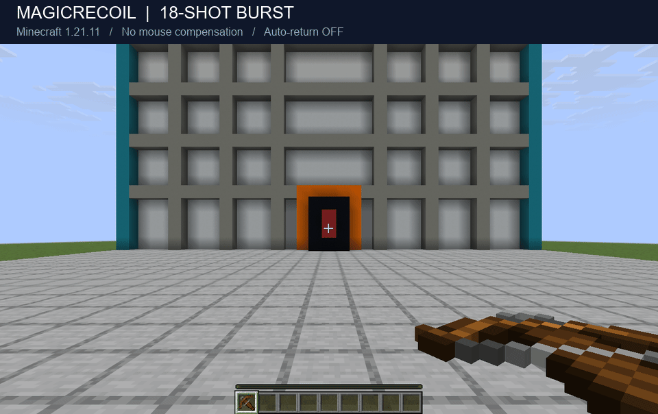

# MagicRecoil

[English](README.md) · [한국어](README.ko.md) · [Documentation](docs/en/README.md) · [한국어 문서](docs/ko/README.md) · [Wiki](https://github.com/minjae9010/MagicRecoil/wiki)

**Camera recoil for existing MagicSpells guns on Paper 1.21.4 and newer.**

MagicRecoil adds a custom `RecoilSpell`. Keep your projectile, ammunition, damage, reload, sound, and firing logic; replace the recoil spell. Each shot adds small relative yaw/pitch impulses over server ticks. Players can compensate with normal mouse movement, and the default configuration never returns them to a saved camera angle.

> **Experimental release.** This is a server-side approximation, not a VALORANT camera animation. A vanilla client receives discrete rotations; there is no frame-rate interpolation contract. Local server/protocol checks and automated tests are documented in [Testing](docs/en/testing.md). Human camera-feel acceptance, real weapon integration, and latency/anti-cheat testing remain necessary.

Start with **[Getting started](docs/en/getting-started.md)**. For missing yaw, open **[Troubleshooting](docs/en/troubleshooting.md)**; use the **[documentation map](docs/en/README.md)** or **[Wiki](https://github.com/minjae9010/MagicRecoil/wiki)** to browse all topics.

Current release: **[v0.3.0-alpha.1](https://github.com/minjae9010/MagicRecoil/releases/tag/v0.3.0-alpha.1)** — headshots, six hit directions, distance damage and hit spells, with existing recoil, right-click firing and zoom.

<!-- toc:start -->
## On this page

- [Headshots, directions, distance damage and hit spells](#headshots-directions-distance-damage-and-hit-spells)
- [Right-click fire and left-click zoom](#right-click-fire-and-left-click-zoom)
- [Recoil demo](#recoil-demo)
- [Requirements](#requirements)
- [Install](#install)
- [A practical gun preset](#a-practical-gun-preset)
- [Recoil calculations and configuration rules](#recoil-calculations-and-configuration-rules)
- [Features](#features)
- [Configuration and examples](#configuration-and-examples)
- [Reload and commands](#reload-and-commands)
- [Build from source](#build-from-source)
- [Limits you should evaluate](#limits-you-should-evaluate)
- [License](#license)
- [Optional aiming](#optional-aiming)
<!-- toc:end -->

## Headshots, directions, distance damage and hit spells

`dev.magicrecoil.spells.HitSpell` supports instant ray shots and direct callbacks from existing `ParticleProjectileSpell` guns. Configure head/body multipliers, the six incoming directions relative to the victim, and a linearly interpolated distance curve. Common, head/body and directional subspells run on valid impacts.

```yaml
MyGun_Hit:
  spell-class: dev.magicrecoil.spells.HitSpell
  helper-spell: true
  can-target: [players, nonplayers]
  damage: 6
  headshot-multiplier: 2
  direction-multipliers: {back: 1.5}
  distance-damage:
    - {distance: 0, multiplier: 1}
    - {distance: 50, multiplier: 0.5}
  # Define this effect spell separately, then uncomment:
  # spell-on-headshot: MyGun_HeadshotEffect
```

For an existing particle projectile, set `spell-on-hit-entity: "MyGun_Hit(targeting=entity_from_location)"`. For instant shots, call `"MyGun_Hit(targeting=none)"` before recoil. Swimming/gliding players include their eye height in the head region; lower body hits remain bodyshots. Replace the prior damage callback to avoid double damage and keep recoil attached to successful firing. [Full guide](docs/en/hit-detection.md) · [complete YAML](examples/hit-integration.yml).

Validation: **216 automated tests** and all **92 two-player PvP/pose cases passed**, including the four formerly failing swimming/gliding eye-height shots. Targets were real connected Player entities driven by headless clients; rendered models, human input, moving targets, latency and protection-plugin combinations remain acceptance checks. Full build/API checks and normal hit/aim/reload regressions are in [Testing](docs/en/testing.md).

## Right-click fire and left-click zoom

| Input | Behavior |
| --- | --- |
| Hold right click | Refill up to five upcoming firing opportunities, using the existing complete firing entry |
| Release right click | Let the remaining buffer drain within five ticks, about 0.25 seconds at 20 TPS |
| Left click | Toggle Slowness-based zoom; movement slows while scoped and recoil stays at multiplier 1.0 |
| Reload, swap, death or logout | Stop firing and clear scope through the configured hooks |

Merge [right-click-paimon.yml](examples/right-click-paimon.yml) and [aim-paimon.yml](examples/aim-paimon.yml) into the existing gun configuration. Keep the current magic item, ammunition variables, reload conditions, projectile, sound and recoil spells. Remove the old firing Buff's mouse bindings so only one firing loop runs. Direct/eventless reload chains must call StopAutoFireSpell first. [Full settings and integration](docs/en/aim-and-input.md) explain the options and legacy controls.

No client mod or ProtocolLib is required. The item is not converted to a spyglass or prepared with use components in BUFFERED_CLICK mode. Zoom depends on the client's FOV Effects setting; 0% disables visible magnification. Its rendered strength and the complete production gun still require in-game acceptance. The current release passes 216 automated tests; the retained firing/scope features also have earlier real Paper input, ammo/recoil, potion-restoration and restart evidence; see [test evidence](docs/en/testing.md#crackshot-controls-verification).

## Recoil demo



Actual Minecraft 1.21.11 frames captured through MCP on a local Paper server: 18 shots, three ticks apart, `auto-return: false`, and no mouse compensation. The crossbow is a visual prop; MagicSpells triggers the shots. The capture runs at approximately **5 FPS**, so use it to see recoil accumulation and the final aim, not to judge live smoothness. See the [recording details](docs/en/testing.md#recorded-recoil-demo) and [reproducible test fixture](tests/runtime/README.md#visual-burst-fixture).

> This GIF records the **legacy 0.1.0-alpha.1 pattern**. Current valorant uses signed offsets around center and a cumulative rise cap, so its results differ.

## Requirements

| Component | Supported target |
| --- | --- |
| Server | Paper **1.21.4+**, with a compatible native rotation API |
| Java | **21+**; use the Java version required by your server (26.x requires Java 25) |
| MagicSpells | **4.0-Beta-17+**, including later beta, RC, and stable releases with compatible APIs |
| Build | Gradle **9.3.0**, wrapper included |
| ProtocolLib | Not required |
| Client | Vanilla Java matching the server; no client mod required for basic recoil |

This project compiles against the checksum-pinned official MagicSpells Beta 17 API and checks the required API contracts at startup. A renamed JAR does not establish binary compatibility. That release includes its own shaded EffectLib. MagicRecoil has no separate EffectLib dependency; keep the dependencies required by your existing MagicSpells distribution. A separately supplied `ms-EffectLib-9.0.jar` was not available for testing.

Version equality locks have been removed. Newer releases are accepted when the required APIs remain compatible; incompatible APIs fail at startup with a diagnostic. The adapter automatically selects relative rotation where available and absolute rotation on older protocols. Absolute packets can overwrite mouse changes during network transit. Folia is unsupported; protocol translators and modified distributions need separate validation. See [Version compatibility](docs/en/compatibility.md) for the support policy and verification matrix.

## Install

1. Build the current `MagicRecoil-0.3.0-alpha.1.jar` below, or select a release with the required compatibility from [Releases](https://github.com/minjae9010/MagicRecoil/releases).
2. Stop the server. Put the JAR in `plugins/` alongside MagicSpells. Do not place another copy inside `plugins/MagicSpells/`.
3. Put the following spell in `plugins/MagicSpells/spells-recoil.yml`:

   ```yaml
   MyGun_Recoil:
     spell-class: "dev.magicrecoil.spells.RecoilSpell"
     recoil: 2.5
   ```

4. Start the server. Check for `Enabled rotation:` and no missing/malformed spell classes.
5. From the console, try `ms cast as PlayerName MyGun_Recoil`. With appropriate MagicSpells permissions/spell ownership, players can use `/ms cast MyGun_Recoil`.
6. For a real gun, follow [Integration](docs/en/integration.md) to gate recoil on successful shots and stop pending recoil on reload.

Use the **full class name**. Beta 18 expands `.RecoilSpell` into MagicSpells' own package, not the addon's package. MagicRecoil registers its class loader through MagicSpells' public API. No MagicSpells JAR patching or duplicate classes are needed.

## A practical gun preset

```yaml
MyGun_Recoil:
  spell-class: "dev.magicrecoil.spells.RecoilSpell"
  helper-spell: true
  recoil: 2.5
  vertical: 1.0
  horizontal: 0.4
  smoothness: 0.8
  growth: 0.08
  reset-delay: 400
  pattern: valorant
  auto-return: false
  require-success-of: MyGun_Projectile
  stop-on-spells: [MyGun_Reload_Start]
  stop-on-buff-end: [MyGun_Firing_Buff]
```

Replace the three referenced names with actual spell names. In the existing successful-fire branch, execute `MyGun_Projectile` immediately before `MyGun_Recoil`, in the same tick. `require-success-of` consumes a single successful cast receipt; it prevents an unrelated recoil call from following a failed projectile attempt. It cannot repair ammunition checks that your gun configuration never performs. In particular, MagicSpells' default partial subcasts do not run all normal cost/cooldown checks.

The projectile fires before the new shot's recoil, and subsequent shots use the updated aim known to the server. Do not put one recoil call after each pellet unless you intentionally want recoil per pellet.

## Recoil calculations and configuration rules

**`horizontal` scales a pattern coefficient; it is not an angle. A zero coefficient remains zero regardless of the multiplier.**

```text
strength = recoil × (1 + growth × shotIndex)  # first shot is 0
yaw   = horizontalCoefficient × horizontal × strength  # positive: right
pitch = -verticalCoefficient × vertical × strength    # negative: up
```

| Intended behavior | Configuration rule |
| --- | --- |
| Upward recoil only | `pattern: vertical`; default bias/bounds give zero yaw regardless of horizontal scaling |
| Initial rise followed by sideways sway | `pattern: valorant`; first **four shots have zero base yaw**, then offsets cross both sides of center; upward recoil stops at `valorant-max-rise` |
| Random sideways motion from the first shot | `pattern: random`, with horizontal bounds and scaling |
| A chosen sequence | `pattern: custom`, with vertical/horizontal coefficients in `custom-pattern` |

For example, the following settings produce **0.5° upward** and a random horizontal delta in **-0.75°..+0.75°** per shot. Put them under an existing `RecoilSpell`, preserving its firing and stop hooks.

```yaml
recoil: 0.5
vertical: 1.0
horizontal: 1.5
pattern: random
vertical-min: 1.0
vertical-max: 1.0
horizontal-min: -1.0
horizontal-max: 1.0
growth: 0.0
recoil-steps: 2
auto-return: false
```

Equal vertical bounds fix that coefficient at 1; otherwise random's default 0..2 interval varies upward strength too. Random yaw does not guarantee alternating directions. Per-shot, per-tick, and view limits can reduce delivered amounts.

Two steps use weights `2/3, 1/3`; explicit `recoil-steps` overrides `smoothness`. `reset-delay` resets burst state rather than returning the camera. With gaps of at least the default 400 ms, valorant repeatedly restarts at shot zero and never reaches its sideways phase.

See **[Recoil logic](docs/en/recoil-logic.md)** for coefficient/noise/bias/limit order, every pattern, overlap, resets, and recovery. For missing yaw, start with **[No sideways motion](docs/en/troubleshooting.md#no-sideways-motion)**.

## Features

- Per-player burst growth and four patterns: `valorant`, `vertical`, `random`, `custom`.
- Numbers-only presets for AR, SMG, LMG, SR, DMR, SG, pistols, or any custom weapon. Categories are not encoded in Java.
- Explicit custom pattern `loop`, `hold`, or `stop` behavior.
- Relative rotation-only packets: no coordinate update, velocity reset, or teleport-confirmation cycle.
- One shared, synchronous scheduler; fixed 20-slot impulse buffer per active player; at most one recoil packet per player per tick.
- Strict finite-number/range validation, per-shot and per-tick limits, pitch clamping.
- Cleanup on weapon/spell switch, inventory interactions, death, logout, teleport, world change, MagicSpells reload, and plugin disable.
- Optional additive recovery, disabled by default. It subtracts delivered recoil and does not restore an absolute aim point.

## Configuration and examples

See the [full configuration reference](docs/en/configuration.md) for units, ranges, formulas, precedence, and advanced options.

| File | Purpose |
| --- | --- |
| [Getting started](docs/en/getting-started.md) | Installation, minimal spell, first console check |
| [Recoil logic](docs/en/recoil-logic.md) | Axis formulas, patterns, splitting, overlap and resets |
| [Troubleshooting](docs/en/troubleshooting.md) | Missing yaw, integration failures, strength and spread |
| [recoil-examples.yml](examples/recoil-examples.yml) | Minimal example, seven weapon presets, custom pattern, stop spell |
| [weapon-integration.yml](examples/weapon-integration.yml) | Replacement for `Weapon_AR_Recoil` only |
| [Integration guide](docs/en/integration.md) | Success gating, reload hooks, weapon migration, troubleshooting |

The integration example uses generic English identifiers such as `Weapon_AR_Recoil` and `Weapon_AR_Projectile`; adapt every reference to your existing gun. It is a replacement fragment, not a verified edit of the complete weapon file. Existing projectile, ammunition, damage, reload, effects, and ON/OFF logic must be preserved and tested against the original.

## Reload and commands

- `/ms reload`: re-read settings, load new recoil spells, cancel pending impulses, reset burst state, and re-register the addon class loader.
- Restart the server after changing Java classes or replacing a JAR. Do not use Bukkit `/reload`, PlugMan, or other hot-unload tools.
- `/magicrecoil status`: adapter, active player count, and lifetime recoil packet count.
- `/magicrecoil reset <player>`: clear pending recoil and the player's success receipt.
- Alias: `/mrecoil`. Both commands require `magicrecoil.admin` (default: operator).

There is no global recoil `config.yml`: each MagicSpells spell owns its settings.

## Build from source

Install a JDK 21 and set `JAVA_HOME` to it. The first build needs internet access for Gradle, the Paper API, the pinned MagicSpells release, and test dependencies.

```sh
# Linux / macOS
./gradlew clean build
```

```powershell
# Windows PowerShell
.\gradlew.bat clean build
```

Output: `build/libs/MagicRecoil-0.3.0-alpha.1.jar`. The `-sources.jar` is source code, not a server plugin. The plugin JAR does not bundle Paper, Minecraft, MagicSpells, ProtocolLib, or EffectLib. It declares Mojang mappings for Paper's runtime. `reobfJar` is not needed for this target.

`./gradlew test` runs automated tests; the HTML report is `build/reports/tests/test/index.html`. GitHub Actions builds and tests on Linux and Windows and uploads the plugin and source JARs. See [Development](docs/en/development.md).

## Limits you should evaluate

- A 20 TPS server supplies roughly 50 ms steps; low TPS increases animation duration. `smoothness` changes the distribution across ticks, not client FPS.
- Network delay means server and client aim cannot be instantaneously identical. Already-in-flight mouse packets may briefly overwrite the server's estimate before the client reports its updated angle. This addon deliberately does not rewrite inbound movement packets.
- The server cannot distinguish arbitrary gun metadata changes in the same slot without integration. Different recoil spells reset the active pattern; silent in-place item replacements should call `StopRecoilSpell` or the reset API.
- Pending impulses finish after firing stops. Burst growth resets after `reset-delay`; a reload/stop hook cancels the tail immediately.
- `auto-return: true` can counteract player compensation. Keep it off for the intended FPS behavior.
- There is no promised elimination of jitter, rubber-banding, or conflicts with other plugins. Compare against RotateSpell on the target server before deployment.

If this does not feel materially better than RotateSpell in your tests, treat acceptance as failed. Frame-time smoothing and stronger input integration require a client mod or a client/server protocol designed for recoil. See [Architecture and investigation](docs/en/architecture.md).

## License

GPL-3.0-only; see [LICENSE](LICENSE). MagicRecoil is independent of MagicSpells, PaperMC, Mojang, Microsoft, and Riot Games. “Valorant” describes the broad rise-then-sway idea, not copied game patterns or an official affiliation.

## Optional aiming

[Aiming and firing configuration](docs/en/aim-and-input.md) covers right-click AutoFire, left-click ADS, weapon-scoped recoil reduction and transient speed modifiers. The primary CrackShot-style mode refills a five-tick firing buffer without changing the gun item. Its left-click Slowness scope keeps the configured recoil unchanged and slows movement while scoped. Native-use and timeout input modes and abilities-packet FOV remain optional. Scope visibility depends on client FOV Effects settings; it is not native spyglass magnification. Existing Buff firing stays available. See the [gun-plugin comparison](docs/en/input-comparison.md) and [Paimon firing example](examples/right-click-paimon.yml). Exact left-click HOLD and automatic spread overrides remain excluded.
