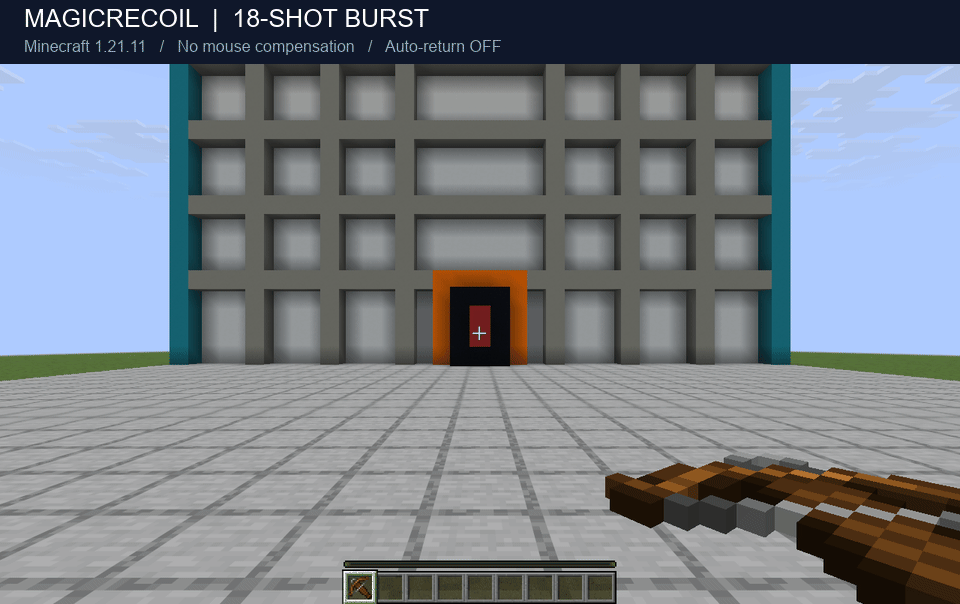

# Validation and acceptance

[English index](README.md) · [한국어](../ko/testing.md)

Status: **experimental / human acceptance pending**. Compilation, local protocol behavior, and subjective camera feel are different claims. This document deliberately separates them.

Separates algorithm checks, running-server observations, and camera feel requiring a person. Use the checklist after installation/integration, or open [Troubleshooting](troubleshooting.md) for a failure.

The detailed measurements below are the original 1.21.11/Beta 18 investigation. The current minimum versions and 2026-11-15 multi-version checks are in [Version compatibility](compatibility.md).

<!-- toc:start -->
## On this page

- [v0.3.0-alpha.3 release checks](#v030-alpha3-release-checks)
- [Hit feature validation](#hit-feature-validation)
- [Player PvP and swimming/gliding validation](#player-pvp-and-swimminggliding-validation)
- [Environment](#environment)
- [Automated checks](#automated-checks)
- [Running-server observations](#running-server-observations)
- [Recorded recoil demo](#recorded-recoil-demo)
- [Human acceptance checklist](#human-acceptance-checklist)
- [Not established by this release](#not-established-by-this-release)
- [ADS extension verification](#ads-extension-verification)
- [Right-click firing and FOV verification](#right-click-firing-and-fov-verification)
- [CrackShot controls verification](#crackshot-controls-verification)
<!-- toc:end -->

## v0.3.0-alpha.3 release checks

All 229 Gradle tests passed. On Paper 1.21.4 / MagicSpells Beta 17, the same shot produced yaw/pitch (1°, -2°) standing, (1.5°, -3°) moving and (0.75°, -1.5°) moving while aimed. Paper 1.21.11 / Beta 18 passed hit, beam, aiming and reload checks. The indicator packet check observed the cooldown gauge on manual single shots and no gauge packets from automatic fire. Human camera feel remains a manual acceptance item.

## Hit feature validation

For v0.3.0-alpha.1 on 2026-11-16, **all 216 tests passed with zero exclusions or skips**, including the swimming/gliding eye-height regressions and the existing aiming, firing, and zoom tests from main. `clean build runtimeProbeJar` passed with the baseline Paper 1.21.4 / MagicSpells Beta 17 API. The complete suite was also checked with Paper 1.21.11 / Beta 18 and Paper 1.21.4 / Beta 19 with Java 25. The earlier isolated hit/aim development build had 182 tests; the release preserves main's additional functionality and tests.

An isolated Paper 1.21.11 / MagicSpells Beta 18 / Java 21 server with a headless client verified:

- Head/rear hit: 4 base × 2 head × 1.5 rear = 12 damage; common/head/rear callbacks each run once.
- Body/front hit: 4 damage; common/body/front callbacks each run once.
- Interpolated falloff at approximately 29.7 blocks against actual target health.
- Wall impacts and misses cause no hit damage/hooks while retaining three existing recoil packets per shot.
- Moving the shooter 30 blocks sideways during particle-projectile flight preserves launch-based damage.
- Omitting the required callback argument causes no damage, hooks, or additional ray shot.
- Both ray and particle shots preserve damage and callback counts after `/ms reload`.
- Aim applies movement speed 0.065 and half recoil, restores speed on toggle/stop/reload, and preserves another plugin's speed modifier.

See [runtime instructions](../../tests/runtime/README.md#hit-detection-smoke-test) to reproduce. Model-specific head regions and production PvP plugins, shields, armor, latency, and anti-cheat combinations still need acceptance testing.

## Player PvP and swimming/gliding validation

On 2026-11-16, 92 runtime cases used **two connected Player entities** on Paper 1.21.11 / MagicSpells Beta 18 / Java 21. These were headless protocol clients, not human input or rendered-model inspection. Swimming began in water and gliding with an equipped elytra in the air; each case checked live swimming/gliding flags, pose, and bounding box without overriding `setPose`. Targets were stationary with gravity disabled, yaw 0°/90°, and pitch 0°. Regeneration was disabled, and damage events, actual health, and subspell counts were recorded together.

| Check | Result |
| --- | --- |
| Standing/swimming/gliding × upper-box/body × six sides × ray/particle | 72/72 passed |
| Front/back/left/right after rotating the victim 90° | 12/12 passed |
| World PvP disabled: no damage or hit callbacks | 2/2 passed |
| Independent expectation that eye-height hits are headshots | 6/6 passed, including the four previously failing swimming/gliding cases |

**All 92 passed after correction.** The [before-fix report](../media/pvp-hit-results-before-eye-fix.json) recorded 88 passes and four failures. Swimming/gliding has a box height of about 0.6 and eyes at about 0.4, below the old head-strip minimum of about 0.45. The corrected region extends down to the actual eyes for these Player poses. Both ray and particle eye-height shots now invoke head callbacks and deal the expected 4 damage, while lower body hits retain 2 damage. Six-direction classification, rotated victims, and world PvP restrictions still pass. Expected damage and callback assertions were not changed.

See the [after-fix per-case JSON](../media/pvp-hit-results.json) and [reproduction instructions](../../tests/runtime/README.md#player-pvp-and-swimminggliding-test). This integration test is separate from the 216 Gradle tests and completed with exit code 0; unmet expectations still cause exit code 1. Moving-target interpolation, other gliding pitches, latency, and production protection-plugin combinations were not covered.

## Environment

- Date: 2026-11-14, Asia/Seoul.
- Windows 11, Azul Zulu JDK 21.0.8, Gradle wrapper 9.3.0.
- Paper 1.21.11 build 132, commit `c5eb0790f199da6c38d0a650e1e5cd5415b28185`.
- Official MagicSpells 4.0-Beta-18, source commit `1996743cacaac8c5742ac146e7ff905caf270f8a`.
- Disposable flat-world server, bound to `127.0.0.1:25579`, offline authentication for the local fixture only.
- Headless `minecraft-protocol` 1.68.0 client speaking protocol 1.21.11. It applies relative rotation fields, reports normal look packets, and records traffic. It does **not** run the vanilla renderer or physical mouse input.
- Separate visual recording: Minecraft 1.21.11 renderer with Fabric 0.20.1 and Minecraft Mod MCP 0.4.3 for framebuffer capture. The capture helper is not a recoil mod or a plugin dependency.

## Automated checks

`./gradlew clean build runtimeProbeJar` succeeds with the real Paper/MagicSpells artifacts. **216 automated tests** pass:

- Strict numeric/type/range validation and all distributed recoil examples.
- First-shot rise, growth, vector caps, left/right sway, random bounds, and custom loop/hold/stop rules.
- Impulse conservation across 1..20 steps, 100,000 consecutive simulated shots, extreme aggregate clipping, and full buffer cancellation.
- Burst timeout reset, default no-return, optional recovery using only delivered deltas.
- Single-use, same-tick success receipts; failure, wrong spell, stale tick, player isolation, logout/reset, reload invalidation, and same-tick stop suppression.
- One scheduler shared by 100 mocked players and correct pending-impulse replacement on weapon switch.

The generated HTML report is `build/reports/tests/test/index.html`. Mocked player tests establish scheduler structure, not capacity for 100 real network clients. The optional probe is built separately and is not included in the shipping plugin JAR.

Current valorant checks additionally verify cumulative left/right offsets, center crossings under growth, angle-based rise limits with different shot strengths, positive floors/noise, and reset behavior beyond a full magazine.

## Running-server observations

| Check | Observed result |
| --- | --- |
| Cold startup/class loading | RecoilSpell and StopRecoilSpell loaded from the addon JAR through the official loader list, before addon enable; no missing-class errors |
| Relative packet shape | Both relative flags true; only yaw/pitch changes; no extra position packet during basic recoil |
| 3° vertical recoil in 3 steps | Received pitch deltas `-1.5`, `-1.0`, `-0.5`; final server and simulated-client pitch `-3°` from zero |
| Position preservation | Position `[10.5, -60, -9.5]` identical before/after the basic recoil test |
| Ungranted success receipt | Calling guarded recoil without its projectile added zero packets |
| Actual projectile + recoil | ParticleProjectileSpell followed by guarded recoil produced one three-step recoil |
| Failed preceding projectile | A targeted dummy with no valid nearby player did not produce guarded recoil |
| Reload-start cancellation | Projectile → recoil → reload-start produced no queued recoil packet |
| Same-tick stop race | Projectile → reload-start → recoil also produced zero recoil packets on the final build |
| `/ms reload` cleanup | A queued cast followed immediately by reload left zero active sessions and no resumed tail |
| Changed YAML | `recoil: 3` changed to `6` via `/ms reload`; next deltas were `-3`, `-2`, `-1` |
| New YAML spell | Newly added `MR_New` loaded on reload and sent its configured single `-1°` delta |
| Synthetic downward input during recoil | Over 20 ticks: `-3°` recoil plus twenty `+0.1°` inputs; initial pitch 7°, final simulated-client ≈6° and server 6° |
| Projectile direction after recoil | Consecutive real particle projectiles launched at yaw 20°, pitches 6° then 3°. Their normalized velocity matched the captured server aim with vector distance `0.0` in both observations |
| Paper API baseline | `Player.setRotation` emitted absolute flags false/false, changed server pitch immediately, and preserved coordinates |
| ProtocolLib comparison | 5.4.0 dependency-inclusive artifact delivered true/true relative flags; raw send left server pitch at 0° immediately, then -3° after the client response. The library warned that 1.21.11 was untested |
| Pitch boundary | With the simulated client looking at -89°, recoil ended at -90° on both client and server; no coordinate change |
| Logout during pending recoil | A queued long impulse followed by a kick left zero active sessions |
| Shutdown | Tasks and plugin state cleaned up on orderly server stop; test server/client are not left running |

The particle-projectile check uses `check-plugins: true` and the separate runtime probe to observe the first tracker velocity. It validates the supplied fixture's launch direction; it does not validate a production weapon that caches a different origin or aim.

Reproduce using [tests/runtime](../../tests/runtime/README.md). The fixture includes a dependency-pinned client, spell YAML, and optional `runtimeProbeJar` task. ProtocolLib is only an optional comparison tool, not a MagicRecoil requirement.

## Recorded recoil demo

This section records **legacy 0.1.0-alpha.1 behavior**, not the current built-in pattern baseline.

Recorded on 2026-11-14 using [spells-demo.yml](../../tests/runtime/spells-demo.yml), the same Paper/MagicSpells/addon versions listed above, and no mouse input. A Mineflayer MCP controller invoked `ms cast as RecoilCamera Demo_Burst`. Each projectile uses `targeting=none` to read the caster's current aim before the new recoil impulse. The held crossbow is a prop; this test does not implement mouse-triggered firing, ammunition, or damage.

| Measurement | Before → after |
| --- | --- |
| Shots / cadence | 18 shots / one per three server ticks |
| Position | `[0.5, -60, -5.5]` → identical |
| Yaw | `0°` → `0.907024°` |
| Pitch | `0°` → `-26.189999°` (upward) |
| Lifetime recoil packet counter | 216 → 270, a difference of 54 |
| Active recoil sessions after the tail | 0 |
| Reported server TPS | 20.0 |
| Auto-return | Disabled; final aim remains raised |

The original 1280×720 PNG frames came from Minecraft's `ScreenshotRecorder`, via a project-specific MCP adapter and [Minecraft Mod MCP](https://github.com/langyo/minecraft-mod-mcp). A local capture-only patch adapts the mod's screenshot entry point to Fabric's 1.21.11 intermediary names and asynchronous screenshot API (Yarn `1.21.11+build.6`). An isolated GLFW library keeps the capture window hidden and prevents desktop input capture. These helpers do not change camera rotation, recoil packets, or MagicRecoil's implementation.

The source capture contains 61 frames over about 12.1 seconds (**approximately 5 FPS**). The README GIF keeps seven seconds at the captured timing, scales the game image to 960×540, and adds a 64-pixel caption strip. It loops; the transition back to the initial target at the loop boundary is the GIF restarting. No generated game frames or motion interpolation are used. This sampling rate does not establish live animation smoothness or human mouse comfort.

See [capture metadata](../media/recoil-demo.json) for hashes and [reproduction steps](../../tests/runtime/README.md#visual-burst-fixture). A normal 1.21.11 client can run the same spell fixture without Fabric or the capture helper.

## Human acceptance checklist

Use a real vanilla 1.21.11 client with the original weapon YAML. Compare identical server TPS, sensitivity, FOV, firing cadence, recoil strength, and network conditions against the old RotateSpell configuration.

1. **Feel:** single shots and 30-shot bursts should have a noticeably better controllable response than the old setup. Record both versions. If there is no useful improvement, do not accept this as meeting the camera-feel requirement.
2. **Mouse control:** pull down and move sideways while firing. Aim must remain responsive; releasing the trigger must not snap back with auto-return disabled. Test near pitch ±90° and yaw wraparound.
3. **Shot gating:** empty magazine, failed cast, cancelled cast, cooldown, reload in progress, and cancelled firing buff must not create unintended recoil. Confirm the actual partial/full/direct/delayed casting mode.
4. **Projectile alignment:** single-shot at a marked wall, then burst and compensate. Compare actual projectile trajectories with the view. Check for a cached location/direction in the original loop.
5. **Lifecycle:** change hotbar slot, swap hands, drop a gun, replace an item in the same slot, die, respawn, disconnect, reconnect, change world, and teleport during a long tail. No old tail should resume.
6. **Reload:** while firing, edit a number and run `/ms reload`; add a new spell; repeat several times. No stale motion or duplicate scheduler should remain. Restart after JAR changes.
7. **Network/TPS:** test representative ping, jitter, and degraded TPS. Look for corrections, camera stepping, rubber-banding, or delayed shots. Localhost results do not establish behavior at 100–200 ms RTT.
8. **Plugin combinations:** repeat with the actual anti-cheat, proxy/protocol translator, and camera/teleport plugins. Test riders and special movement modes if your server uses them.
9. **Load:** profile the intended number of simultaneously firing players with spark. Check main-thread time, packet rate, memory after logout, and TPS. Expect at most one recoil packet per active player per server tick, not one packet per animation object.

## Not established by this release

- Perceptual superiority over RotateSpell or a native VALORANT-like renderer.
- Real mouse comfort, high-latency synchronization, anti-cheat compatibility, or a production concurrency limit.
- Correctness of the missing original production gun, its ammunition variables, reload conditions, or custom `ms-*.jar` binaries.
- Minecraft 26.3, Folia, and combinations beyond the checks listed in [Version compatibility](compatibility.md).

A client mod with frame-based additive recoil is the next step if the vanilla client cannot meet the feel requirement. This alpha should be evaluated, not described as having completed that acceptance test.

---

[Previous: Troubleshooting](troubleshooting.md) · [Documentation](README.md) · [Next: Architecture](architecture.md)

## ADS extension verification

**Initial ADS build: 86 unit tests passed. The final firing/FOV extension build below passes 115 tests, zero failures/skips.**

Test date: **2026-11-15 (Asia/Seoul)**. Target: Paper **1.21.11 build 132**, commit **c5eb079**, official MagicSpells **4.0-Beta-18**, Java **21.0.8**, Gradle **9.3.0**.

- Automated: the existing recoil tests plus ADS configuration validation, repeated toggle, modifier ownership, slot/F cancellation flags, item suspension/resume, idempotent activation, reload attempts and async rejection pass. All four recoil patterns are compared shot-for-shot at half strength across 100 shots each; mixed ADS recovery and zero strength are checked.
- Real server with two synthetic protocol clients: native main-hand right-click routing; normal 2-degree versus aimed 1-degree recoil; actual hotbar and F packets; independent players; missing reagents, exact cost charging, cooldown and modifier rejection; external speed modifier preservation; BuffEnd, reload, logout, death/respawn and `/ms reload` cleanup and re-registration pass. Baseline speed `0.10000000149` became `0.06500000097`; an external total multiplier gave `0.12000000179`, aimed `0.07800000116`, then restored `0.12000000179`. No ProtocolLib was installed. The rerunnable fixture clears its own reagent items and sets peaceful difficulty so ambient mobs cannot kill idle test clients.
- Representative Paimon fixture: Buff → PassiveSpell → Beam → success-gated recoil preserves ammunition consumption and reload blocking while ADS scales recoil. This intentionally omits the production damage types, sounds, resource pack and external commands.
- The fixture stops Paper with ADS active; transient modifier cleanup, clean restart and join are checked by rerunning the fixture against the same disposable server. This is not a JVM crash test.

Run [the committed ADS fixture](../../tests/runtime/README.md#ads-integration-fixture). Its headless clients do not render FOV or measure physical walking speed. Human mouse feel, off-hand duplicate-item bindings, interactable blocks, network latency/anti-cheat and the complete production Paimon configuration remain acceptance checks. Exact left-click HOLD, native spyglass and automatic spread have no implementation to test. See the new firing/FOV checks below for right-click tracking and optional FOV packets.

## Right-click firing and FOV verification

Final Java 21 `clean build runtimeProbeJar`: **115 unit tests passed**, no failures/skips. The same Paper 1.21.11 / official Beta 18 environment above was used with two protocol clients and no ProtocolLib. This is a real server with synthetic input, not a rendered-client acceptance test.

| Check | Observed result |
| --- | --- |
| Native right-click | One use packet on a diamond hoe starts repeated full firing calls. Received use release stops them; ammo stays stable afterward. Scoped recoil matches ammo consumed at 0.75 degrees per shot in the fixture |
| Repeated-click compatibility | An unmodified blaze rod receives four right-click pulses four ticks apart, continues firing, then stops after the configured six-tick gap. No temporary component is added |
| Reload stop | Cast-event reload and direct/eventless StopAutoFireSpell stop and latch firing; clearing the reload variable alone does not resume it. A new released/repressed input does |
| Lifecycle | Real slot/F packets, death and `/ms reload` terminate active native firing. Both ADS and firing are active when the harness requests normal server shutdown; rerunning against the same server checks restart and join |
| Left-click FOV | An arm-animation packet toggles ADS. The outgoing abilities walking-speed field matches the configured factor and current movement attribute; flight/creative flags are preserved. Server walk speed remains 0.1 and the base attribute remains 0.1. Unscoping restores current real abilities |
| Legacy compatibility | Existing Buff/Passive/Beam and successful-fire recoil checks remain in the same harness; costs, cooldowns, modifiers and two-player isolation continue to pass |

The harness does not render the zoom, physically hold a mouse, simulate packet loss, or validate an anti-cheat. FOV Effects at 0% disables this optional zoom by the vanilla client formula; real visual strength and restoration still need human testing at 0% and 100%, with sprint/flight and the intended plugin/resource-pack combination. Native-use item components also need production inventory and interactable-block acceptance. No JVM crash test or CrackShot runtime test is claimed. The CrackShot result is a separately documented [static official-JAR inspection](input-comparison.md#crackshot-binary-verification).

## CrackShot controls verification

The final build passes **115 JUnit tests**, including five-tick input buffering, duplicate-event bounds, continuous refills, item-change cleanup, reload latching and Slowness configuration. The real Paper fixture also checks a golden hoe with custom-model-data 12 and custom data. The item's hash remains identical before/after firing and zoom, and it has neither a preparation marker nor native use state. A single click at a two-tick firing interval consumes exactly three rounds; each keeps the existing 1.5-degree recoil even while scoped. Repeated pulses refill the buffer; after the final pulse it drains and ammunition stays fixed.

Left-click toggles Slowness III and back, reducing the movement attribute to 0.055 from 0.1 while server walking abilities remain unchanged. The prior active Slowness is restored with less remaining time. A newer external amplifier-4 Slowness effect remains after scope ends. Slot change, reload and /ms reload remove the scope. The harness requests normal shutdown with potion scope and buffered firing active; rerunning it checks restart and join. Synthetic clients still do not render the FOV; visual strength and real mouse/network acceptance remain separate.
