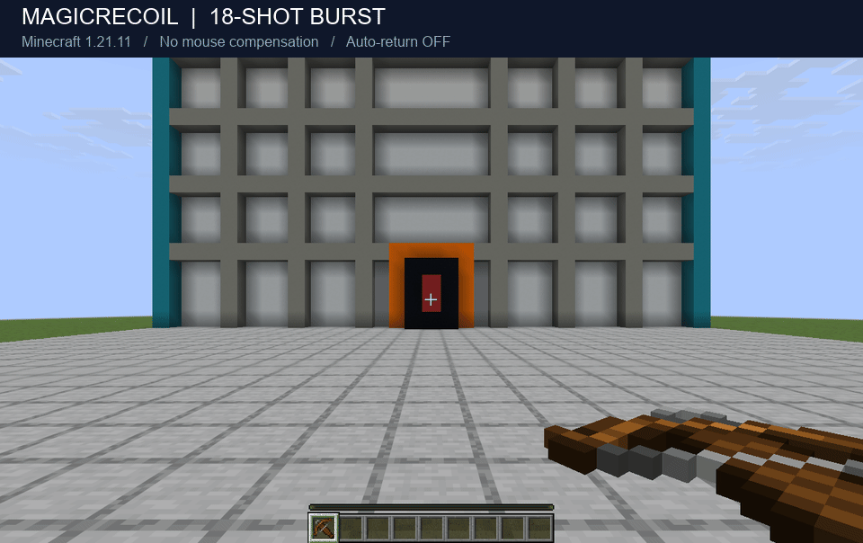

# 검증 결과와 도입 승인

[한국어 목차](README.md) · [English](../en/testing.md)

현재 상태는 **실험 버전 / 실제 사용자 조작감 승인 전**입니다. 컴파일 성공, 서버 프로토콜 동작, 사람이 느끼는 부드러움은 서로 다른 검증 항목입니다.

## 시험 환경

- 2026-11-14, Asia/Seoul 기준.
- Windows 11, Azul Zulu JDK 21.0.8, Gradle Wrapper 9.3.0.
- Paper 1.21.11 132번, 커밋 `c5eb0790f199da6c38d0a650e1e5cd5415b28185`.
- 공식 MagicSpells 4.0-Beta-18, 소스 커밋 `1996743cacaac8c5742ac146e7ff905caf270f8a`.
- 일회용 평지 월드, `127.0.0.1:25579`에만 열린 로컬 서버. 시험용 클라이언트만을 위한 오프라인 인증.
- minecraft-protocol 1.68.0 기반 헤드리스 클라이언트. 1.21.11 패킷을 해석하고 상대 회전 및 일반 look 응답을 처리하지만 바닐라 렌더러나 실제 마우스를 실행하지는 않습니다.
- 별도 화면 녹화: Minecraft 1.21.11 렌더러와 Fabric 0.20.1, 프레임버퍼 캡처용 Minecraft Mod MCP 0.4.3. 캡처 도구는 반동 모드나 플러그인 실행 의존성이 아닙니다.

## 자동 검증

실제 Paper/MagicSpells 의존성을 사용한 `./gradlew clean build runtimeProbeJar`가 성공하고 **44개 자동 테스트**가 통과했습니다.

- 숫자·타입·범위 검사 및 배포 예시 YAML 전체 파싱.
- 첫 발 상승, 연사 증가, 벡터 제한, 좌우 패턴, 무작위 범위, custom의 loop/hold/stop.
- 1~20틱 반동 합계 보존, 100,000발 연속 시뮬레이션, 과도한 반동 제한, 버퍼 취소.
- 시간 초과 초기화, 기본 자동 복귀 없음, 실제 전달량만 사용하는 선택적 복귀.
- 같은 틱에서 한 번만 쓰는 성공 기록, 실패·다른 주문·이전 틱·플레이어 분리·초기화·리로드·중지 처리.
- 모의 플레이어 100명이 공용 작업 하나를 쓰는지, 무기 교체 때 이전 반동이 제거되는지 확인.

보고서는 `build/reports/tests/test/index.html`입니다. 모의 플레이어 검증은 실제 100명 네트워크 부하 시험이 아닙니다. 별도 진단 플러그인은 배포용 MagicRecoil JAR에 들어가지 않습니다.

## 실제 서버에서 관찰한 결과

| 항목 | 결과 |
| --- | --- |
| 최초 시작·클래스 로딩 | 공식 로더 목록을 통해 RecoilSpell과 StopRecoilSpell 로딩. 클래스 누락 오류 없음 |
| 상대 패킷 | relative yaw/pitch 모두 true. 기본 반동 중 추가 위치 패킷 없음 |
| 3°를 3틱에 적용 | pitch -1.5°, -1°, -0.5° 수신. 시작 0°에서 서버·모의 클라이언트 최종 -3° |
| 위치 유지 | 반동 전후 좌표 `[10.5, -60, -9.5]` 동일 |
| 성공 기록 없는 호출 | 조건부 반동을 단독 실행하면 패킷 증가 없음 |
| 실제 발사체와 반동 | ParticleProjectileSpell 뒤의 조건부 반동이 3단계로 한 번 적용 |
| 앞 주문 실패 | 주변 유효 플레이어가 없어 실패한 targeted dummy 뒤에서는 반동 없음 |
| 재장전 중지 | 발사체 → 반동 → 재장전 시작 순서에서 예약 패킷 취소 |
| 같은 틱의 중지 순서 | 최종 빌드에서 발사체 → 재장전 시작 → 반동 순서도 패킷 0개 |
| `/ms reload` 정리 | 반동 예약 직후 리로드하면 활성 상태 0, 이전 반동 재개 없음 |
| YAML 변경 | recoil을 3에서 6으로 변경 후 리로드, -3°/-2°/-1°로 적용 |
| 새 주문 추가 | MR_New를 추가하고 리로드한 뒤 지정한 -1° 단일 변화량 수신 |
| 반동 중 아래 입력 | 20틱의 -3° 반동과 매 패킷 +0.1° 입력을 합산. 시작 pitch 7°에서 최종 클라이언트 약 6°, 서버 6° |
| 실제 발사체 방향 | yaw 20°, pitch 6°와 반동 후 3°에서 연속 발사. 두 발 모두 발사체 정규화 속도와 시전 당시 서버 조준 벡터의 거리 0.0 |
| Paper API 비교 | Player.setRotation은 relative 플래그 false/false, 즉시 서버 시점 변경, 위치 유지 |
| ProtocolLib 비교 | 5.4.0 all JAR로 true/true 상대 패킷 수신. 단순 송신 직후 서버 pitch 0°, 클라이언트 응답 후 -3°. 라이브러리는 1.21.11 미검증 경고 출력 |
| 시점 경계 | 모의 클라이언트가 -89°를 보는 상태에서 반동 후 양쪽 최종 -90°, 위치 유지 |
| 남은 반동 중 로그아웃 | 긴 반동 예약 후 퇴장시키면 활성 세션 0 |
| 정상 종료 | 서버 stop 시 작업과 플러그인 상태 정리 |

발사체 시험은 `check-plugins: true`와 별도 진단 플러그인으로 첫 이동 속도를 확인합니다. 제공된 시험 주문의 방향을 확인한 것이며 원본 총기에 저장된 다른 위치·방향 데이터를 대신 검증하지는 않습니다.

재현용 설정, 버전을 고정한 Node 클라이언트, 선택적 진단 JAR은 [tests/runtime](../../tests/runtime/README.md)에 있습니다. ProtocolLib은 비교 시험용이며 애드온 실행 의존성이 아닙니다.

## 반동 시연 녹화

2026-11-14에 [spells-demo.yml](../../tests/runtime/spells-demo.yml)과 위의 Paper/MagicSpells/애드온 버전으로 촬영했습니다. Mineflayer MCP가 `ms cast as RecoilCamera Demo_Burst`를 실행했으며 마우스 입력은 없었습니다. 발사체는 `targeting=none`으로 매 발 현재 시전자 방향을 읽은 뒤 새 반동을 적용합니다. 손에 든 석궁은 표시용이며 이 구성에는 마우스 발사 연결, 탄약, 데미지 처리가 없습니다.

| 측정 항목 | 전 → 후 |
| --- | --- |
| 발사 수 / 간격 | 18발 / 서버 3틱마다 한 발 |
| 위치 | `[0.5, -60, -5.5]` → 동일 |
| Yaw | `0°` → `0.907024°` |
| Pitch | `0°` → `-26.189999°` (위쪽) |
| 누적 반동 패킷 카운터 | 216 → 270, 총 54개 증가 |
| 잔여 반동 종료 후 활성 세션 | 0 |
| 서버 보고 TPS | 20.0 |
| 자동 복귀 | 비활성화, 올라간 시점 유지 |

1280×720 원본 PNG는 프로젝트 전용 MCP 어댑터와 [Minecraft Mod MCP](https://github.com/langyo/minecraft-mod-mcp)를 거쳐 게임의 `ScreenshotRecorder`에서 직접 얻었습니다. 캡처 도구의 화면 호출 부분만 Fabric 1.21.11 클래스 이름과 비동기 스크린샷 API에 맞췄습니다(Yarn `1.21.11+build.6`). 별도 GLFW 라이브러리로 녹화 창을 숨기고 데스크톱 입력을 잡지 않게 했습니다. 시점 회전, 반동 패킷, MagicRecoil 구현은 변경하지 않았습니다.

원본은 약 12.1초 동안 61프레임으로, 캡처 속도는 **약 5 FPS**입니다. GIF는 원래 시간 간격을 유지한 7초 구간을 사용하며 게임 화면을 960×540으로 축소하고 위에 64픽셀 설명 띠를 추가했습니다. 반복 경계에서 처음 표적으로 돌아가는 것은 GIF의 재시작입니다. 게임 화면을 합성하거나 중간 움직임을 생성하지 않았습니다. 이 프레임률로 실시간 부드러움이나 실제 마우스 조작감을 판정할 수는 없습니다.

해시는 [촬영 메타데이터](../media/recoil-demo.json), 재현 방법은 [테스트 안내](../../tests/runtime/README.md#visual-burst-fixture)에 있습니다. 촬영 도구 없이 일반 1.21.11 클라이언트에서도 같은 주문을 실행할 수 있습니다.

한국어 재현 순서:

1. 테스트 서버의 `plugins/MagicSpells/`에 `spells-demo.yml`을 복사하고 콘솔에서 `ms reload`를 실행합니다.
2. 클라이언트로 접속하여 표시가 있는 벽을 바라봅니다. 녹화 예시 위치는 `[0.5, -60, -5.5]`, yaw/pitch는 `0/0`입니다.
3. 녹화를 시작하고 콘솔에서 `ms cast as 플레이어이름 Demo_Burst`를 실행합니다. 실제 주문 이름은 영어 `Demo_Burst`입니다.
4. 마우스를 움직이지 않고 연사 종료 뒤에도 잠시 촬영하여 자동 복귀 여부를 확인합니다. 발사 중 슬롯 변경이나 텔레포트는 잔여 반동을 취소하므로 피합니다.
5. 선택적 진단 플러그인이 있으면 전후 `mrprobe snapshot 플레이어이름`과 `magicrecoil status` 결과를 비교합니다.

## 실제 사용자 승인 체크리스트

바닐라 1.21.11 클라이언트와 원본 총기 YAML을 사용합니다. TPS, 감도, FOV, 발사 간격, 강도, 네트워크 조건을 맞추어 기존 RotateSpell과 비교하세요.

1. **조작감:** 단발과 30발 연사를 영상으로 비교합니다. 유의미한 개선이 없다면 요청한 반동 감각을 충족한 것으로 승인하지 않습니다.
2. **마우스:** 아래로 당기고 좌우로 움직이며 연사합니다. 입력이 유지되는지, auto-return false에서 원점으로 튀지 않는지, pitch ±90°와 yaw 경계를 확인합니다.
3. **발사 조건:** 탄약 없음, 시전 실패/취소, 쿨다운, 재장전 중, 발사 버프 취소에서 원치 않는 반동이 없어야 합니다. 실제 partial/full/direct/delayed 방식을 확인합니다.
4. **탄도:** 표시한 벽에 단발·연사·반동 제어를 시험하고 시점과 실제 탄환 방향을 비교합니다. 발사 루프가 옛 방향을 저장하는지 확인합니다.
5. **생명주기:** 긴 반동 도중 핫바·손 교환·아이템 버리기·동일 슬롯 교체·사망·리스폰·로그아웃·재접속·월드 이동·텔레포트를 수행합니다. 옛 반동이 재개되면 안 됩니다.
6. **리로드:** 발사 중 숫자를 바꾸고 `/ms reload`, 새 주문 추가, 반복 리로드를 시험합니다. 오래된 반동과 중복 작업이 없어야 합니다. JAR 변경은 재시작합니다.
7. **지연/TPS:** 실제 예상 ping, 지터, TPS 저하 조건에서 화면 단계감, 위치 보정, 고무줄 현상, 늦은 발사를 확인합니다. localhost 결과는 100~200ms 환경의 검증이 아닙니다.
8. **플러그인 조합:** 실제 안티치트·프록시·버전 변환·카메라/텔레포트 플러그인과 조합하고 서버에서 사용하는 탈것·특수 이동도 확인합니다.
9. **부하:** 목표 동시 사격 인원으로 spark를 사용해 틱 시간, 패킷 수, 로그아웃 후 메모리, TPS를 확인합니다. 애드온 반동 패킷은 활성 플레이어마다 서버 틱당 최대 하나입니다.

## 아직 확인하지 못한 항목

- RotateSpell 대비 실제 체감 우위, VALORANT와 같은 렌더링.
- 실제 마우스의 편안함, 높은 지연에서 동기화, 안티치트 호환, 실서버 동접 한계.
- 첨부되지 않은 원본 실서버 총기와 탄약·재장전 조건, 별도 ms-*.jar 바이너리.
- Minecraft 26.3, Folia, 다른 MagicSpells 버전.

바닐라에서 원하는 감각을 얻지 못하면 클라이언트 모드의 프레임 단위 상대 반동을 다음 대안으로 검토해야 합니다. 이 알파 버전을 조작감 검수까지 완료한 제품으로 설명해서는 안 됩니다.
